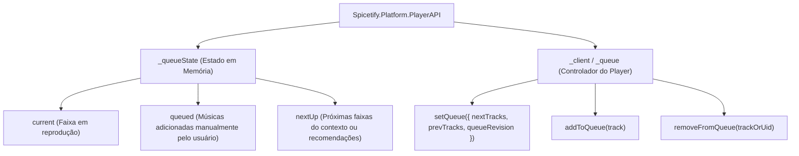
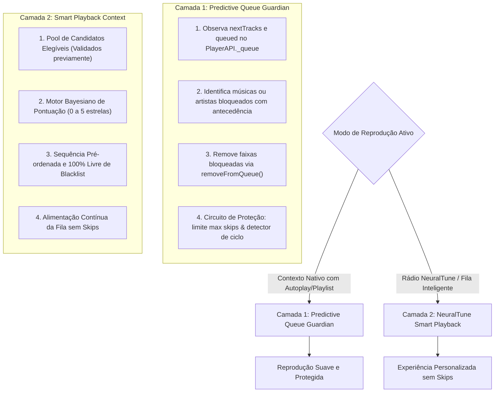

# 01 — ARQUITETURA SPOTIFY, SPICETIFY & DIAGNÓSTICO LOCAL

## Projeto NeuralTune — Engenharia Reversa e Personalização Musical

---

## 1. INVENTÁRIO DO AMBIENTE LOCAL

A investigação inicial foi realizada em modo estritamente **somente-leitura**, inspecionando o sistema operacional, os diretórios de instalação, os processos ativos e os artefatos de integração do Spotify e Spicetify nesta estação Windows 11.

### 1.1 Identificação do Software e Versões

| Componente | Localização no Disco | Versão Detectada |
|---|---|---|
| **Spotify Desktop Client** | `%USERPROFILE%\AppData\Roaming\Spotify\Spotify.exe` | **1.3.5.3058.g5d40d5480152** |
| **Spicetify CLI** | `%USERPROFILE%\AppData\Local\spicetify\spicetify.exe` | **2.46.3** |
| **Spicetify Data/Config** | `%USERPROFILE%\AppData\Roaming\spicetify` | Config: `config-xpui.ini` |
| **Node.js Runtime** | `C:\Program Files\nodejs\node.exe` | **v24.13.0** |
| **NPM** | `C:\Program Files\nodejs\npm.ps1` | **11.21.1** |
| **Git** | `C:\Program Files\Git\cmd\git.exe` | Presente |
| **Cache & Storage Spotify** | `%USERPROFILE%\AppData\Local\Spotify` | Diretório de cache CEF e armazenamento local |

### 1.2 Configuração Ativa do Spicetify (`config-xpui.ini`)

```ini
[Setting]
spotify_path           = %USERPROFILE%\AppData\Roaming\Spotify
prefs_path             = %USERPROFILE%\AppData\Roaming\Spotify\prefs
current_theme          = marketplace
inject_theme_js        = 1
inject_css             = 1
replace_colors         = 1
check_spicetify_update = 1

[Preprocesses]
remove_rtl_rule    = 1
expose_apis        = 1
disable_sentry     = 1
disable_ui_logging = 1

[AdditionalOptions]
home_config           = 1
experimental_features = 1
extensions            = trashbin.js|victor-spotify-atalhos.js
custom_apps           = marketplace
sidebar_config        = 0
```

> **Destaque:** `expose_apis = 1` e `experimental_features = 1` estão habilitados, garantindo acesso completo aos módulos internos do Webpack e APIs de plataforma do Spotify via `Spicetify`.

---

## 2. ARQUITETURA DE PROCESSOS E LINHA DE BASE DE DESEMPENHO

O Spotify Desktop utiliza a arquitetura **Chromium Embedded Framework (CEF)** combinada com um runtime nativo em C++ (`Spotify.dll`, `libcef.dll`).

### 2.1 Mapeamento Real de Processos (Medição em Tempo Real)

Abaixo estão os dados reais capturados diretamente do subsistema de processos do Windows 11 para o cliente em execução:

```
Process ID  Tipo do Processo    Working Set (RAM)  PageFile (Commit)  Tempo CPU (Kernel + User)
19608       browser (Main)      341.5 MB           215.2 MB           30.42 s
22944       renderer (XPUI)     324.9 MB           252.6 MB           35.61 s
35124       gpu-process         118.2 MB           201.9 MB            6.42 s
 6028       renderer (Aux)      116.2 MB            62.0 MB            0.50 s
21256       utility (Audio/Net)  97.9 MB            78.0 MB            2.59 s
 8836       utility (Storage)    55.3 MB            28.8 MB            4.39 s
27284       utility (Misc)       38.5 MB            28.6 MB            0.52 s
26632       crashpad-handler     12.3 MB             2.9 MB            0.03 s
-----------------------------------------------------------------------------------------
TOTAL EM EXECUÇÃO: 8 Processos | ~1.104,8 MB (~1,1 GB RAM) | 80,48 s CPU acumulados
```

### 2.2 Diagnóstico dos Gargalos de Desempenho

1. **Camada de Renderização XPUI (`renderer` PID 22944):**
   - A interface do Spotify roda uma SPA React massiva empacotada em Webpack/Rspack (`Apps\xpui\vendor~xpui.js`, `xpui.js`).
   - Cada renderização e cada transição de faixa geram mutações no DOM em toda a barra de reprodução (`main-nowPlayingBar-container`), na lista de reprodução atual e nas capas de álbum.
   - Extensões com múltiplos `MutationObserver` globais ou listeners síncronos de `songchange` bloqueiam o Event Loop do renderer, causando os congelamentos perceptíveis da interface.

2. **Consumo de Memória:**
   - O consumo do processo renderer (324 MB) somado ao browser (341 MB) totaliza mais de 660 MB apenas para carregar o cliente e uma biblioteca padrão.
   - O uso excessivo de `localStorage` síncrono (que serializa/desserializa strings JSON com milhares de URIs na thread principal da UI) gera latência e micro-travamentos (*jank*).

3. **Arquitetura de Processos Dividida:**
   - `gpu-process` (118 MB) cuida da aceleração de hardware e composição de camadas.
   - `utility (Audio/Net)` lida com streaming seguro e decodificação local.

---

## 3. INVESTIGAÇÃO PROFUNDA DA TRASH BIN & MECANISMOS DE FILA

### 3.1 Anatomia da Falha Estrutural da Trash Bin

O arquivo inspecionado em `%USERPROFILE%\AppData\Local\spicetify\Extensions\trashbin.js` revela a causa raiz exata do problema dos "skips sucessivos":

```javascript
// Trecho de trashbin.js (Linhas 232 e 248-264)
Spicetify.Player.addEventListener("songchange", watchChange);

function watchChange() {
    const data = Spicetify.Player.data || Spicetify.Queue;
    if (!data) return;

    const isBanned = trashSongList[data.item.uri];
    // ...
    if (isBanned) {
        Spicetify.Player.next(); // <--- O PONTO CRÍTICO
        return;
    }
    // ... verificação de artistas rejeitados ...
    if (trashArtistList[artistUri]) {
        Spicetify.Player.next();
        return;
    }
}
```

#### Por que isso causa loops e engasgos graves?
1. **Atuação Reativa e Tardia:**
   A Trash Bin só avalia a música **depois** que o Spotify já a carregou como faixa ativa (`songchange`). O motor de áudio começa o pré-carregamento, a interface renderiza o título e a capa, e o evento é disparado. Apenas nesse instante o `Spicetify.Player.next()` é acionado.
2. **Avalanche de Skips em Sequência:**
   Se a próxima faixa também estiver bloqueada, o processo se repete: novo carregamento de áudio, novo evento `songchange`, novo `next()`. Se houver 20, 50 ou 100 músicas bloqueadas na fila gerada por rádio ou autoplay, ocorrem dezenas de transições de estado por segundo, estrangulando o renderer CEF.
3. **Ausência Total de Detecção de Ciclo / Loop Infinito:**
   A Trash Bin não possui contador de avanço por unidade de tempo nem detecção de ciclo. Se um contexto tiver apenas músicas bloqueadas e o modo de repetição estiver ativo, o cliente entra em um loop infinito de `next()`.
4. **Armazenamento Síncrono no LocalStorage:**
   `JSON.parse(Spicetify.LocalStorage.get("TrashSongList"))` roda no fluxo síncrono, penalizando o desempenho conforme a lista de bloqueios cresce.

---

## 4. MAPEAMENTO DAS APIS DE REPRODUÇÃO E FILAS DO SPOTIFY

Ao inspecionar `spicetifyWrapper.js` e a estrutura do `vendor~xpui.js`, mapeamos a arquitetura interna da fila do Spotify:

### 4.1 Estrutura Interna da Fila (`Spicetify.Platform.PlayerAPI._queue`)

O subsistema de fila possui dois objetos principais:



### 4.2 Métodos e Interfaces Verificadas

1. **`Spicetify.Queue` / `Spicetify.Player.origin._queue._state`:**
   - `queued`: Array de faixas enfileiradas explicitamente pelo usuário (`is_queued: true`).
   - `nextUp`: Array de faixas futuras programadas pelo contexto ativo (playlist, álbum ou rádio).
   - `current`: Metadados da faixa corrente (`uri`, `uid`, `metadata`).

2. **`Spicetify.removeFromQueue([{ uri, uid }])`:**
   - Remove faixas da fila pendente antes que cheguem à reprodução, permitindo a **pré-filtragem não-destrutiva**.

3. **`_client.setQueue({ nextTracks, prevTracks, queueRevision })`:**
   - Método de baixo nível verificado em extensões como `shuffle+.js`. Permite substituir ou reordenar a sequência de `nextTracks` diretamente no cliente CEF.

4. **`Spicetify.getAudioData(uri)`:**
   - Faz chamada autenticada a `https://spclient.wg.spotify.com/audio-attributes/v1/audio-analysis/{id}`.
   - Retorna metadados acústicos reais: **tempo/BPM, tonalidade (key), energia, dançabilidade, acústica, valência (positividade), instrumentalidade e vivacidade**.

5. **`Spicetify.GraphQL.Request`:**
   - Permite consultar discografia, faixas mais populares do artista, lançamentos e álbuns sem depender de chamadas à Web API externa sujeitas a restrições ou quotas rígidas.

---

## 5. ESTRATÉGIA TÉCNICA DO NEURALTUNE

### 5.1 Arquitetura em Duas Camadas para Eliminação de Skips

Para garantir que músicas rejeitadas nunca gerem sequências de skips, o NeuralTune implementa uma abordagem em duas camadas:



#### Camada 1: Predictive Queue Guardian
- Monitora os eventos de atualização da fila (`PlayerAPI._events` e `queue_revision`).
- Faz varredura preditiva nos próximos candidatos visíveis (`nextTracks`).
- Quando encontra uma faixa rejeitada (nota 0 ou artista bloqueado), remove-a antecipadamente usando `Spicetify.removeFromQueue` antes que o player avance para ela.
- **Proteção contra loops:** Mantém janela deslizante de transições; se mais de 3 skips ocorrerem em 2 segundos ou se for detectado ciclo fechado, pausa a reprodução e exibe notificação explicativa clara ao usuário.

#### Camada 2: NeuralTune Smart Playback
- Para rádios personalizadas e exploração musical, o NeuralTune assume o gerenciamento prévio do buffer de candidatos.
- Os candidatos são obtidos a partir de fontes permitidas (biblioteca do usuário, discografias via GraphQL ou playlists selecionadas).
- Toda a filtragem determinística (blacklist) e pontuação de preferências ocorre **antes** de enviar as músicas à fila do Spotify.
- Resultado: **zero skips** durante a reprodução, com garantia técnica de integridade.

---

## 6. MODELAGEM DA PERSISTÊNCIA E MOTOR DE PREFERÊNCIAS

### 6.1 Persistência de Alto Desempenho (IndexedDB com Cache em Memória)
- Substituição do armazenamento monolítico em `localStorage` por **IndexedDB** (`NeuralTuneDB`).
- Cache em memória utilizando `Set<string>` e `Map<string, number>` para verificação $O(1)$ de bloqueios com zero custo de I/O na thread de reprodução.
- Suporte a transações seguras, histórico de auditoria e exportação/importação JSON.

### 6.2 Motor Multidimensional de Preferências (0 a 5 Estrelas)

| Nota | Significado | Efeito Determinístico | Efeito Estatístico nos Atributos |
|---|---|---|---|
| **0** | Rejeição Total | Blacklist permanente da faixa (desfazível) | Penalidade proporcional suavizada (não extingue o gênero/artista) |
| **1** | Detesto | Fora das seleções personalizadas | Penalidade moderada nos atributos |
| **2** | Não gosto | Baixa prioridade | Penalidade leve nos atributos |
| **3** | Indiferente | Neutro | Sem alteração nos pesos |
| **4** | Gosto | Prioritário | Reforço positivo nos atributos |
| **5** | Adoro | Máxima prioridade | Forte reforço positivo e âncora de similaridade |

---

## 7. MATRIZ DE VIABILIDADE TÉCNICA E LIMITAÇÕES

| Funcionalidade | Viabilidade Técnica | Mecanismo de Implementação |
|---|---|---|
| **Avaliação 0 a 5 Estrelas na UI** | **100% Viável** | `Spicetify.Playbar.Widget` + atalhos de teclado (`Keyboard`) |
| **Predictive Queue Guardian** | **100% Viável** | `PlayerAPI._queue` + `removeFromQueue` + detector de ciclo |
| **Smart Playback sem Skips** | **100% Viável** | Buffer pré-filtrado gerenciado pelo NeuralTune via `_client.setQueue` / `addToQueue` |
| **Extração de Atributos Acústicos** | **100% Viável** | Endpoint interno `Spicetify.getAudioData` / audio-attributes |
| **Consulta de Artistas e Álbuns** | **100% Viável** | `Spicetify.GraphQL.Request` |
| **Importação da Trash Bin** | **100% Viável** | Leitura de `TrashSongList` e `TrashArtistList` do `LocalStorage` |
| **Controle de Recomendações dos Servidores do Spotify** | **Inacessível remotamente** | O algoritmo proprietário roda na nuvem do Spotify; a influência legítima ocorre no filtro prévio e na injeção da fila local |

---
*Documento gerado como entregável da Fase A do Projeto NeuralTune.*
